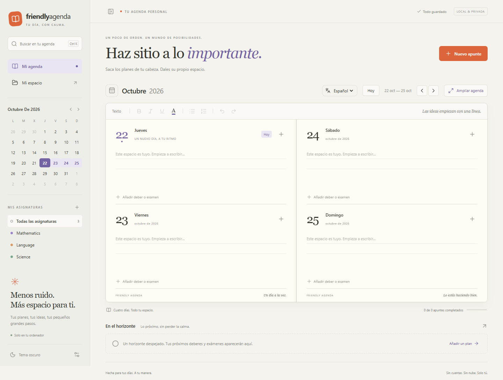

# FriendlyAgenda

Una agenda de papel, en digital. Aplicación de escritorio para Windows y macOS, de código abierto y con datos locales.



## Usar la aplicación

Descarga la versión de tu ordenador desde [la última versión publicada](https://github.com/kuaanii/FriendlyAgenda/releases/latest):

| Sistema                                          | Archivo                                |
| ------------------------------------------------ | -------------------------------------- |
| Windows x64                                      | `FriendlyAgenda-0.6.0-Windows.exe`     |
| Mac con Apple Silicon (M1, M2, M3 y posteriores) | `FriendlyAgenda-0.6.0-macOS-arm64.dmg` |
| Mac con procesador Intel                         | `FriendlyAgenda-0.6.0-macOS-x64.dmg`   |

En Windows, guarda el ejecutable portable en una carpeta fija (puedes llamarlo **FriendlyAgenda.exe**) y crea un acceso a ese archivo; no necesita instalación. En Mac, abre el DMG, arrastra **FriendlyAgenda** a **Aplicaciones**, expulsa la imagen y abre la aplicación desde Aplicaciones. Puedes comprobar el procesador en ** → Acerca de este Mac**. Cierra la versión anterior antes del primer reemplazo manual.

Estas versiones no tienen un certificado de distribución comercial. Las aplicaciones de Mac llevan firma ad hoc para comprobar la integridad local, pero no están notarizadas por Apple. macOS puede bloquear la primera apertura: revisa el origen de la descarga y usa **Ajustes del Sistema → Privacidad y seguridad → Abrir igualmente**, si aparece. No es necesario desactivar las protecciones del sistema. Más información en [la ayuda de Apple](https://support.apple.com/es-es/102445).

La interfaz arranca en **inglés** por defecto. El selector **English / Español / Français**, junto a las fechas, cambia el idioma al instante y sigue disponible en el modo agenda ampliada. Se recuerda localmente, también al exportar una copia. No traduce ni modifica tus notas o los nombres de tus asignaturas. Las agendas antiguas sin preferencia de idioma se abren en inglés conservando su contenido. Los ejemplos de botones siguientes corresponden al idioma español.

- Cada doble página muestra cuatro días consecutivos, dos en cada hoja. Las flechas avanzan o retroceden cuatro días; el calendario permite saltar a otra fecha.
- Pulsa el espacio de notas para escribir. Selecciona texto y usa los botones de negrita, cursiva, subrayado, color o listas. También funcionan los atajos habituales de edición.
- Añade apuntes desde **Nuevo apunte** o desde un día. Tipos disponibles: deber, examen, entrega, cumpleaños, reunión, cita, clase, estudio, vacaciones, evento y otro. Pulsa un apunte para editarlo; su casilla permite completarlo.
- Elige **Todo el día** o una **Hora de entrega o inicio**, con hora de fin opcional. Puedes añadir lugar, detalles y un recordatorio: a la hora indicada, 5/15/30/60 minutos antes o un día antes. Las horas son locales al ordenador.
- Crea o cambia el nombre y color de asignaturas con el botón **+** de la barra lateral. Al elegir una asignatura se filtran los apuntes; las notas libres siguen visibles.
- Busca notas y apuntes con **Ctrl+K** en Windows o **⌘K** en Mac. Las agendas nuevas siguen el tema del sistema y cambian al instante cuando este cambia. En **Mi espacio → Apariencia** puedes elegir Sistema, claro u oscuro; la preferencia se recuerda. Las agendas anteriores conservan su elección de tema.
- **Ampliar agenda**, junto a las fechas, dedica toda la ventana a la doble página. **Volver** o **Esc** recuperan la página principal. Las notas y las fechas se mantienen al cambiar de modo. Si hay un diálogo abierto, **Esc** cierra primero ese diálogo.
- El botón de la esquina superior izquierda oculta y vuelve a mostrar el menú lateral.
- Las barras de desplazamiento están ocultas. Puedes seguir desplazándote con la rueda, el trackpad y el teclado. En ambas vistas, cada día permite desplazar sus notas largas de forma independiente sin invadir el siguiente día.

## Datos y copias

La aplicación guarda automáticamente en `%APPDATA%/FriendlyAgenda/data/agenda.json` en Windows y en `~/Library/Application Support/FriendlyAgenda/data/agenda.json` en Mac. **Mi espacio → Abrir carpeta de datos** muestra la ubicación exacta. No requiere cuenta ni usa telemetría, fuentes remotas o un servidor para guardar tu agenda.

## Recordatorios y segundo plano

En **Mi espacio → Notificaciones**, activa **Avisarme de los apuntes pendientes** y usa **Probar notificación**. Windows o macOS deben permitir los avisos de FriendlyAgenda; el modo Concentración / No molestar puede ocultarlos. En Windows, al habilitarlos se prepara un acceso al menú Inicio para registrar la identidad de las notificaciones. Conserva el ejecutable en una carpeta permanente.

Cada apunte tiene su propio recordatorio, que puede desactivarse. Los apuntes antiguos sin ese ajuste usan la hora prevista al activar las notificaciones. Los de todo el día avisan a las 09:00 por defecto; esa hora se puede cambiar. Los completados dejan de avisar. Si un aviso se perdió con la aplicación cerrada o el equipo suspendido, se recupera al volver a ejecutarse. Los atrasados se recuerdan una vez al día, a la hora configurada, durante un máximo de siete días. Se conserva un historial local para evitar repetir los ya mostrados.

Con **Mantener en segundo plano al cerrar** activado, cerrar la ventana conserva la agenda junto al reloj de Windows o en la barra de menús de Mac. Ese icono permite **Abrir agenda** y **Salir de FriendlyAgenda**. Al desactivar esta opción, cerrar la ventana termina la aplicación cuando las notificaciones están activadas. **La aplicación debe seguir ejecutándose para avisar**: no arranca automáticamente con el ordenador, no avisa con el equipo apagado y no lo despierta. No necesita conexión a Internet.

## Importar calendarios

Abre **Mi espacio → Importar calendario**, elige el intervalo de fechas y el archivo exportado. La vista previa permite seleccionar apuntes antes de añadirlos. **La importación conserva las notas y apuntes existentes** y omite los eventos ya importados, manteniendo las ediciones hechas en la agenda. Es una importación puntual, sin sincronización ni acceso a tus cuentas.

| Origen                                  | Archivo local                                                                         |
| --------------------------------------- | ------------------------------------------------------------------------------------- |
| Google Calendar                         | `.ics` de su exportación; descomprime primero el ZIP. También admite su CSV habitual. |
| Microsoft Outlook                       | `.ics` o CSV de calendario.                                                           |
| Apple Calendar                          | Exportación `.ics`.                                                                   |
| Yahoo Calendar, Proton Calendar y otros | Exportación iCalendar `.ics` compatible.                                              |

Para CSV, selecciona día/mes/año o mes/día/año según la exportación. Las fechas ISO también se aceptan. En ICS se respetan las zonas horarias, las exclusiones y las excepciones de las series; las horas se convierten a la zona del ordenador en el momento de importar. Los eventos de todo el día mantienen su fecha. Las repeticiones del intervalo y los eventos de varios días se convierten en apuntes independientes. No se crean series que se prolonguen indefinidamente: importa otro intervalo cuando lo necesites.

Se conservan título, lugar y descripción como texto. Las alarmas originales no se importan: puedes activar nuevos recordatorios para la selección en la vista previa. No se importan adjuntos, asistentes ni tareas VTODO. Se admiten archivos de hasta 20 MB, intervalos de hasta cinco años y un máximo de 5.000 apuntes por importación. Los archivos inválidos o demasiado complejos se rechazan; el análisis se ejecuta fuera del proceso principal para mantener la aplicación disponible.

## Actualizaciones

Desde la versión 0.3.0 se comprueban las versiones estables publicadas en GitHub al abrir la aplicación, cada seis horas y al recuperar la conexión. Si hay una versión superior con una descarga para tu sistema y arquitectura, aparece un aviso con **Ahora no** y **Descargar nueva versión**. Si se pospone, vuelve a avisar en la siguiente apertura o comprobación periódica. También puedes comprobarlo en **Mi espacio → Buscar actualizaciones**.

La consulta usa la API pública de `kuaanii/FriendlyAgenda`. Desde 0.3.1, si la API está limitada o falla, se comprueba el enlace público de la última Release y la existencia del ejecutable mediante peticiones de cabecera, sin descargarlo. Solo se aceptan enlaces del repositorio y de los assets oficiales de GitHub. No envía notas, asignaturas, credenciales ni identificadores de usuario; GitHub recibe los datos normales de una conexión web, como la dirección IP. Sin Internet la agenda sigue funcionando. Los cambios de código o las etiquetas sin una GitHub Release con ejecutable no generan un aviso de actualización.

Desde **0.6.0**, al elegir descargar se guarda y verifica la actualización en una caché privada, sin abrir el navegador. **Reiniciar para actualizar** guarda las notas y sustituye el mismo archivo de Windows o el mismo paquete .app de Mac. Se mantienen el acceso y los datos. La copia de recuperación se elimina al comprobar el primer arranque válido. Si no se puede sustituir o iniciar el archivo, se conserva o restaura la versión anterior. La carpeta de la app debe ser escribible; en Mac no se actualiza desde el DMG montado, y el desarrollo no puede sustituir el runtime Electron.

Las versiones **0.5.1 y anteriores** necesitan un último reemplazo manual para incorporar este sistema. Después las actualizaciones se realizan dentro de la app. No se eliminan otras copias o instaladores antiguos que ya hubieras guardado por tu cuenta.

Cada guardado conserva la versión anterior en `agenda.json.bak` y sustituye el archivo principal mediante un archivo temporal. Si el principal está dañado, se intenta recuperar la copia y se conserva el dañado en `agenda.json.corrupt`. Si ambos son ilegibles, la aplicación muestra el error sin sustituirlos.

En **Mi espacio** puedes exportar un JSON y restaurarlo más adelante. La importación comprueba la estructura y pide confirmar la sustitución; exporta primero la agenda actual para conservarla por separado. La copia automática anterior se va renovando: no sustituye una copia externa periódica.

Los datos se guardan en el perfil del usuario, separados de la aplicación; sustituir el ejecutable o la aplicación de Mac conserva la agenda. La agenda no cifra sus archivos. La protección de los archivos depende de tu sesión del sistema.

## Desarrollo

Requisitos: Node.js 24 y pnpm 11. El código usa React, Vite, Tiptap y Electron. El análisis de iCalendar utiliza `node-ical` en un worker local, sin descargar calendarios ni recursos de Internet. Todo el editor y sus recursos se incluyen en el ejecutable.

```powershell
pnpm install --frozen-lockfile
pnpm test
pnpm dev
```

`pnpm dev` abre un servidor de desarrollo local. La vista en navegador utiliza almacenamiento local del navegador para previsualizar; los datos de la aplicación de escritorio son independientes.

```powershell
pnpm build
pnpm start
pnpm pack
```

`pnpm pack` o `pnpm pack:win` genera el ejecutable de Windows en `release/`. En un Mac, `pnpm pack:mac` genera el DMG de su arquitectura nativa. El flujo [Desktop builds](.github/workflows/desktop.yml) compila y prueba Windows x64, macOS Intel y macOS Apple Silicon en sus respectivos sistemas. Puede ejecutarse manualmente en GitHub Actions o al subir una etiqueta `v*`. Los binarios se guardan como artefactos de esa ejecución; no se publica una Release automáticamente. Para compilar se necesita Internet la primera vez, cuando se descargan Electron y las herramientas de empaquetado. La aplicación terminada funciona sin conexión.

## Verificación

```powershell
pnpm test
pnpm exec playwright install chromium
pnpm exec playwright test
pnpm test:desktop
```

Para usar un navegador Chromium ya instalado, define `PLAYWRIGHT_EXECUTABLE_PATH` con su ruta. Las pruebas de interfaz usan un perfil temporal independiente. Las pruebas de avisos simulan la entrega nativa para no mostrar notificaciones reales ni solicitar permisos en los equipos de prueba; verifican el planificador, el historial, el registro de Windows y el ciclo de la bandeja a través de IPC real. Usa **Probar notificación** en tu equipo para comprobar sus permisos y configuración del sistema.

Para verificar el programa empaquetado, define `FRIENDLY_AGENDA_EXE` con la ruta absoluta de `release/win-unpacked/FriendlyAgenda.exe` y ejecuta `pnpm test:desktop`. En Mac, `FRIENDLY_AGENDA_EXE` debe apuntar al ejecutable dentro de `FriendlyAgenda.app/Contents/MacOS/FriendlyAgenda`. El ensayo utiliza una carpeta temporal mediante `FRIENDLY_AGENDA_DATA_DIR`, sin tocar la agenda del usuario.

Se comprueban navegación entre años y años bisiestos, conservación del formato, guardado y recuperación desde disco, rechazo de copias inválidas, creación y finalización de deberes, búsqueda y persistencia del tema. Las capturas de ambos temas se guardan en `docs/screenshots/`.

La agenda admite hasta 20 MB de datos serializados. Los casos detectados y corregidos durante la revisión están en [docs/revision.md](docs/revision.md). `pnpm audit:publication` revisa archivos actuales y blobs de todo el historial de Git para detectar nombres sensibles, credenciales, rutas personales, correos y metadatos de imágenes. Es una comprobación preventiva, no una garantía de detección de cualquier secreto.

## Licencia

MIT. Puedes estudiar, modificar y redistribuir el código. Repositorio: [kuaanii/FriendlyAgenda](https://github.com/kuaanii/FriendlyAgenda). Para publicar nuevas versiones, consulta [RELEASING.md](RELEASING.md).

## Añadir un idioma

Los mensajes están en `src/locales/en.json`, `es.json` y `fr.json`; las claves compartidas identifican cada frase. Para añadir un idioma, crea un catálogo con las mismas claves y variables, regístralo en `src/i18n.js` y en la validación de `src/model.js`. Las pruebas comprueban la paridad de los catálogos y la conservación del contenido al cambiar de idioma. Los diálogos propios y menús se traducen; los controles nativos del sistema siguen la configuración de macOS o Windows.
