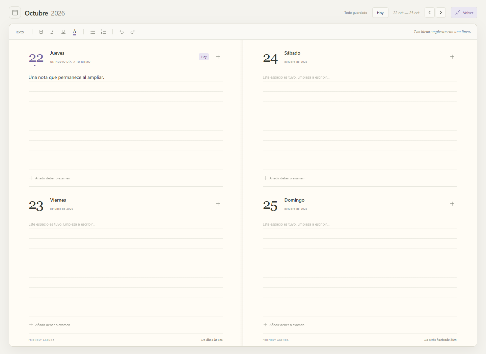

# FriendlyAgenda 0.2.0

- Barras de desplazamiento ocultas en toda la interfaz. Se conserva el desplazamiento con rueda, trackpad y teclado.
- Menú lateral plegable con el botón de la esquina superior izquierda.
- **Ampliar agenda** ocupa el espacio de la aplicación con la doble página. Oculta la navegación y los bloques secundarios; conserva las herramientas de escritura, el estado de guardado y la navegación por fechas.
- **Volver** o **Esc** recuperan la vista principal. Un diálogo abierto se cierra antes de abandonar el modo inmersivo. Se respeta la visibilidad previa del menú lateral.
- Las notas largas se desplazan dentro de su día y no hacen crecer la ventana de la agenda ampliada.
- Compatible con los datos de 0.1.0, sin migración.

## Verificación

6 pruebas de datos, 9 de interfaz y una de escritorio, todas superadas. Las pruebas nuevas cubren plegar y desplegar el menú, ampliar y volver sin perder notas, Escape con diálogos, los temas claro y oscuro y notas largas a 1000×720. La prueba de escritorio también se ha ejecutado sobre el programa empaquetado, con datos temporales y sin conexión.

